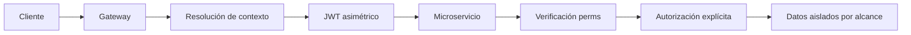

# Requirements

### Overview & Goals
Evolucionar `perms` como librería común de identidad, contexto y autorización para microservicios multi-organización/multi-tenant, sin implementar todavía cambios de código. La propuesta debe preservar los usos actuales cuando sea razonable y separar claramente autenticación, resolución de contexto y autorización.

### Scope
**In scope**
- Modelo tipado de actor, usuario representado, organización y tenant opcionales.
- Ámbitos `Platform`, `Organization`, `Tenant` y `Personal`.
- Comprobación explícita de permisos junto con el ámbito y sus identificadores.
- Contrato seguro para transportar contexto desde gateway a servicios mediante JWT firmado asimétricamente.
- API pública de construcción/validación/consulta/autorización y estrategia de migración.
- Documentación, ejemplos y pruebas previstas para la fase posterior.

**Out of scope**
- Resolución DNS/hostname, selección de organización desde dominios, branding o configuración de negocio.
- Persistencia de membresías/permisos, consultas MongoDB o lógica de expedientes.
- Sustituir la autorización local de cada microservicio por una autorización exclusiva del gateway.
- Implementación inmediata: esta entrega es únicamente auditoría y arquitectura.

### Functional Requirements
- Un contexto debe identificar el actor real y, cuando aplique, el usuario en cuyo nombre actúa.
- `organization_id` y `tenant_id` deben ser opcionales; las operaciones de plataforma no deben requerirlos.
- El tipo de actor no debe conceder permisos implícitos.
- Un permiso solo será válido si coincide su nombre, ámbito y alcance de identificadores.
- Los servicios deben poder rechazar contextos ausentes, expirados, mal firmados o incompatibles antes de autorizar.
- Debe existir identidad para servicios internos y trazabilidad mediante identificadores de petición/origen.
- El frontend no podrá establecer unilateralmente organización o tenant.
- La API heredada basada en `Claims`, `decode_token` y `has_permission` se mantendrá temporalmente o tendrá una migración documentada si resulta incompatible.

# Technical Design

### Current Implementation
- `src/lib.rs:1-8` solo declara `domains_id`, `permissions` y `token`, y reexporta `UserID`, `AuthID`, `has_permission`, `PermLibError`, `Auth`, `Claims`, `Role`, `Token` y `decode_token`.
- `src/token.rs:8-72` contiene roles globales (`SuperAdmin`, `Agency*`, `TenantAdmin`, etc.) y conversiones numéricas/textuales.
- `src/token.rs:74-80` define `Claims` con `sub`, `exp`, `permissions: Vec<String>` y `role_id`; `Token::new` y `decode_token` usan JWT HMAC con secreto compartido (`src/token.rs:101-134`).
- `src/permissions.rs:4-27` extrae `Authorization: Bearer`, decodifica directamente desde `HttpRequest` y solo busca coincidencia de permiso; no valida actor, ámbito, organización o tenant.
- `src/domains_id.rs:5-9` ofrece `UserID` y `AuthID` como wrappers de `mongodb::bson::oid::ObjectId`.
- `examples/simple_usage.rs:1-34` documenta el consumo manual de roles/claims. No hay tests propios, consumidores adicionales ni código de gateway/NATS en este repositorio; el build actual pasa.

### Key Decisions
- Introducir una API de contexto separada del adaptador HTTP: `perms` recibirá un contexto ya resuelto y no interpretará dominios, DNS ni cabeceras de negocio.
- Priorizar JWT firmado asimétricamente para el contexto inter-servicio: el gateway emite claims confiables y cada servicio verifica con clave pública, reduciendo el riesgo y el acoplamiento de secretos HMAC compartidos. Se deberá definir `issuer`, `audience`, expiración, `key id`, algoritmo permitido y rotación.
- Mantener la autorización como operación explícita y local al microservicio: el contexto identifica alcance, pero nunca concede permisos por sí mismo.
- Representar alcance con un enum tipado y datos opcionales asociados, evitando exigir organización/tenant en `Platform` y permitiendo `Personal` sin organización.
- Conservar una capa de compatibilidad para el JWT/claims actual mientras los servicios migran al contexto verificado; no reinterpretar roles heredados como permisos multi-tenant automáticamente.

### Proposed Changes
Añadir módulos conceptuales para `context`, `scope`, `authorization` y `transport`/verificación, exportados desde `src/lib.rs`. El contexto validado deberá ser inmutable tras su verificación y contener únicamente datos necesarios: actor, identidad representada opcional, alcance, permisos o una consulta de permisos, y metadatos de trazabilidad.

La verificación deberá separar: (1) parseo del bearer/JWT, (2) validación criptográfica y de claims estándar, (3) validación semántica de consistencia —por ejemplo, `Tenant` requiere organización y tenant— y (4) autorización de una acción contra el alcance solicitado. El adaptador Actix actual puede delegar en esta lógica, sin hacer que el núcleo dependa de `HttpRequest`.

La política de autorización debe impedir que un permiso `Organization` de una organización se use en otra, que un permiso `Tenant` se use fuera del tenant indicado y que un permiso `Platform` se trate automáticamente como acceso universal sin una regla explícita. Los servicios deberán seguir aplicando filtros de aislamiento en sus repositorios/consultas.

### Data Models / Contracts
Propuesta conceptual, sujeta a nombres finales conforme a las convenciones del crate:

```rust
pub enum ActorType { User, OrganizationWorker, OrganizationAdmin, PlatformAdmin, Service }
pub enum Scope { Platform, Organization { organization_id: OrganizationId }, Tenant { organization_id: OrganizationId, tenant_id: TenantId }, Personal { user_id: UserID } }
pub struct RequestContext { actor_id: ActorId, actor_type: ActorType, on_behalf_of: Option<UserID>, scope: Scope, permissions: PermissionSet, trace: TraceContext }
pub struct Permission { name: String, scope: Scope }
impl RequestContext { pub fn authorize(&self, permission: &str, required_scope: &Scope) -> Result<(), AuthorizationError>; }
```

Los identificadores de organización/tenant deben ser wrappers propios serializables, sin reutilizar `UserID`/`AuthID` si sus invariantes son distintas. El contrato JWT debe incluir identidad del actor, `on_behalf_of` opcional, scope serializado, permisos/claims de autorización, `iss`, `aud`, `iat`, `exp`, `jti` y `kid`; los detalles sensibles de membresía no deben confiarse a datos no firmados.

### Architecture Diagram


### Compatibility & Migration
- Mantener `Claims`, `decode_token`, `Token` y `has_permission` como compatibilidad marcada/documentada durante una transición.
- Añadir constructores/adaptadores desde claims heredados solo para escenarios sin scope, evitando inventar `organization_id` o `tenant_id`.
- Introducir primero tipos y validación sin modificar consumidores; después migrar cada servicio a verificación de contexto y `authorize`.
- Marcar el HMAC heredado como mecanismo de compatibilidad y recomendar el nuevo verificador asimétrico para nuevos flujos; cualquier eliminación futura requerirá una versión mayor.
- La librería no decidirá membresías ni resolverá IDs: gateway/servicio de identidad los determina y el microservicio valida que el token y su audiencia sean propios.

### Risks
- Claims de permisos demasiado amplios o semántica ambigua de roles: mitigar con scopes explícitos, deny-by-default y pruebas de matriz.
- Rotación/revocación de claves: requerirá `kid`, distribución segura de claves públicas y política de expiración corta.
- Confundir contexto firmado con autorización suficiente: documentar y probar que cada servicio autoriza y filtra datos localmente.
- Incompatibilidad de tipos de ID entre microservicios: definir serialización estable y validación estricta antes de publicar el contrato.

# Testing

### Validation Approach
- Añadir pruebas unitarias de serialización/deserialización y validación semántica del contexto.
- Probar firma/verificación JWT asimétrica con audiencia, issuer, expiración, `kid` y algoritmo permitido.
- Probar autorización positiva y negativa combinando permiso, `Scope` y diferentes IDs.

### Key Scenarios
- Usuario personal autorizado para su propio `user_id` y rechazado para otro.
- Trabajador autorizado en una organización y tenant concretos, rechazado en otra organización o tenant.
- Administrador de organización autorizado sin tenant, pero rechazado para operaciones de otra organización.
- Administrador de plataforma autorizado en `Platform` sin IDs organizativos.
- Servicio interno identificado y autorizado únicamente para acciones permitidas.

### Edge Cases
- Contextos con `tenant_id` sin `organization_id`, scopes incompatibles o IDs ausentes.
- JWT manipulado, firmado con clave incorrecta, expirado, con audiencia/issuer incorrectos o algoritmo no permitido.
- Permiso correcto por nombre pero con scope distinto.
- Contexto recibido sin firma confiable o proveniente de una fuente no autorizada.
- Regresión de `decode_token`, `Token::new` y `has_permission` heredados.

# Delivery Steps

### ✓ Step 1: Documentar auditoría y contrato de seguridad
Queda documentado el estado actual de `perms` y el contrato de confianza JWT que usará el contexto inter-servicio.
- Consolidar hallazgos de `src/lib.rs`, `src/token.rs`, `src/permissions.rs`, `src/domains_id.rs` y `examples/simple_usage.rs`.
- Especificar claims estándar, algoritmo asimétrico, `issuer`, `audience`, `kid`, expiración y rotación de claves.
- Delimitar responsabilidades de gateway, servicios y librería.

### ✓ Step 2: Implementar modelo tipado de contexto y ámbitos
`perms` dispone de tipos independientes para actor, contexto, identificadores y scopes opcionales.
- Añadir los módulos de contexto y scope siguiendo la organización modular de `src/lib.rs`.
- Modelar `Platform`, `Organization`, `Tenant` y `Personal` con invariantes explícitas.
- Incorporar trazabilidad y soporte para actor usuario, actor delegado y servicio interno.
- Mantener wrappers existentes y definir serialización compatible para nuevos IDs.

### ✓ Step 3: Añadir verificación de contexto y autorización
Los microservicios pueden verificar un contexto firmado y autorizar acciones respetando su scope.
- Separar parseo HTTP de verificación criptográfica y validación semántica.
- Implementar verificación JWT asimétrica con restricciones de issuer, audience, algoritmo, expiración y `kid`.
- Implementar `authorize`/consultas equivalentes que comparen permiso, scope y IDs.
- Mantener adaptadores de compatibilidad para `Claims`, `decode_token` y `has_permission` sin inventar contexto.

### ✓ Step 4: Validar migración y documentar integración
La API nueva queda cubierta por pruebas y los consumidores disponen de una ruta de migración documentada.
- Añadir pruebas unitarias de scopes, aislamiento, tokens inválidos y actores de servicio.
- Actualizar `examples/simple_usage.rs` con un flujo de contexto verificado y autorización explícita.
- Documentar la migración desde HMAC/roles heredados y los cambios incompatibles futuros.
- Verificar que el crate compila y que la API heredada conserva su comportamiento durante la transición.